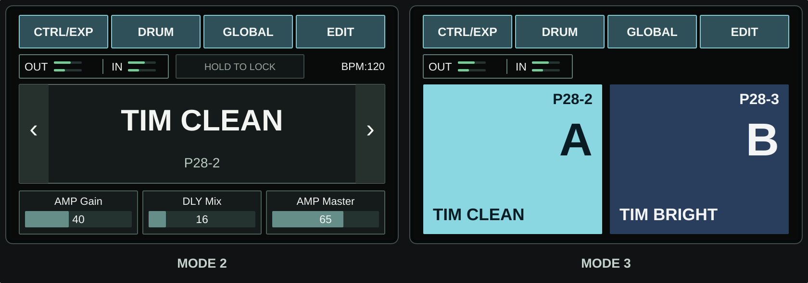
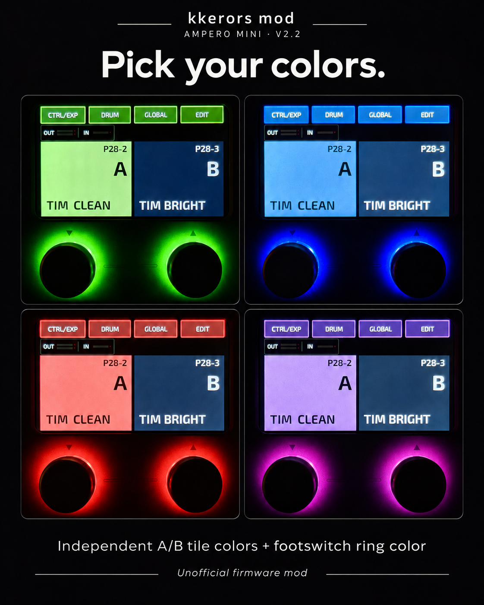

# kkerors mod for Ampero Mini

Custom firmware based on **Hotone Ampero Mini V2.2**. Adds a dedicated A/B display mode and configurable footswitch ring colors.

**[Open the browser patcher](https://teslatess.github.io/kkerors-ampero-mini/)**



## What it adds

- **Mode 3:** two assignable presets, A and B, with preset numbers and names.
- Select A/B by tapping a tile or short-pressing the corresponding footswitch.
- Hold an on-screen tile to choose its preset and color. SAVE applies both; BACK cancels both.
- Independent A/B tile colors and a global **BUTTON COLOR** setting for the footswitch rings.
- Stock Mode 1 and Mode 2 remain available.

A/B selects two separate presets; gapless switching is not added. Gold and Orange have different screen colors but use the same physical LED ring mask.



## Build and install

1. Back up presets and keep original IR, Sound Clone files and the official firmware. Read the [backup guide](docs/BACKUP_GUIDE.md).
2. Obtain the original **Ampero Mini V2.2** from [Hotone](https://www.hotone.com/products/multi-effects/Ampero%20Mini), and extract its `.bin`.
3. Open the [patcher](https://teslatess.github.io/kkerors-ampero-mini/), select the original file and build the mod.
4. Download **`V2.2_kkerors-mod.bin`** and install it with a compatible Ampero Editor using Hotone's update instructions. Do not disconnect power or USB while flashing.

The input stays in your browser. The patcher checks the original and generated files by SHA-256. No original or complete modified firmware is distributed in this repository.

## Controls

- Mode 3: **Global → Display → DISPLAY MODE → Mode 3**.
- Tile assignment: hold the **on-screen** A or B tile, choose a preset and color, then SAVE.
- Footswitch ring color: **Global → Display → next page → BUTTON COLOR**.
- Individual physical footswitch holds do not assign presets in Mode 3. The combined-switch action is passed to stock handling.

## Status

Experimental custom firmware. Software checks pass. Device photos show the interface on hardware; they do not establish complete validation of audio, persistence or recovery. Keep backups and the original firmware for reverting.

## Local development

Requires Python 3.9+, clang and Node.js 22+. ARM instruction checks additionally need a compatible objdump.

```sh
python3 -m http.server 8765 --bind 127.0.0.1 --directory docs
```

Open http://localhost:8765. Use HTTPS for deployment. Opening the page directly via `file://` is not supported.

```sh
npm test
python3 source/menu/build.py '/path/to/official-V2.2.bin' '/path/to/new-output.bin'
python3 source/menu/check.py '/path/to/official-V2.2.bin'
python3 tests/check_patch.py '/path/to/official-V2.2.bin' '/path/to/reference-mod.bin'
node tests/check_browser_patch.mjs '/path/to/official-V2.2.bin' '/path/to/reference-mod.bin'
```

See [patch format and generation](docs/PATCH_FORMAT.md). Tests compare the generated file byte-for-byte with the reference build. Public CI does not include proprietary firmware.

## License

See [LICENSE](LICENSE) and [third-party notices](THIRD_PARTY_NOTICES.md).
An unofficial project, not affiliated with Hotone. The code license does not license stock firmware or trademarks.
